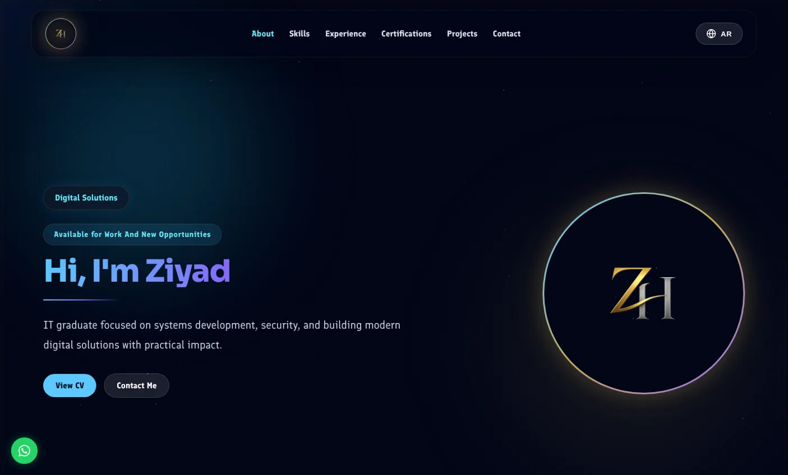
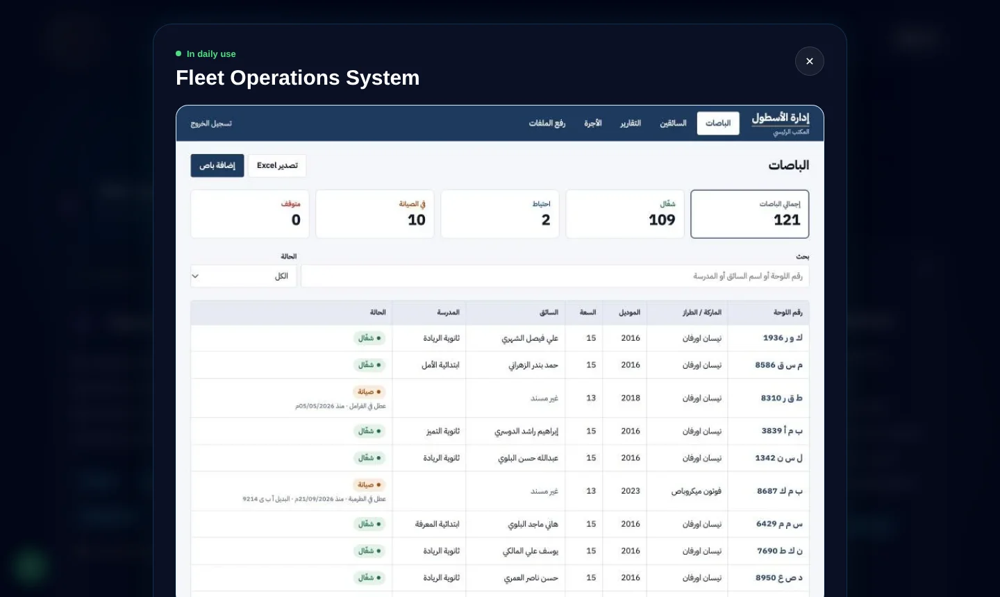

# Ziyad Alfaifi — Portfolio

Personal portfolio of **Ziyad Alfaifi**, Full Stack Web Developer and Information Security graduate.
Bilingual (English / Arabic with full RTL support), responsive, and built with React.

**Live site:** [ziyad7.com](https://ziyad7.com)



## Features

- **Bilingual UI** — one click switches the whole site between English (LTR) and Arabic (RTL).
- **Project case studies** — internal systems open in a modal with screenshots, problem, solution, key features, tech stack, and outcome.
- **Experience timeline, skills, and certifications** sections.
- **Responsive design** for desktop, tablet, and mobile.
- **Smooth animations** with Framer Motion (scroll reveals, hover states, modal transitions).
- **Keyboard-friendly modal** — closes with `Esc`, background scroll is locked while open.



## Tech stack

| Area | Tools |
|---|---|
| UI | React 19, JSX, inline style objects + scoped CSS |
| Animation | Framer Motion |
| Icons | Lucide, React Icons |
| Build | Vite |
| Hosting | Continuous deployment from `main` |

## Run locally

```bash
git clone https://github.com/Ziyad-web-developer/ziyad-portfolio.git
cd ziyad-portfolio
npm install
npm run dev       # start the dev server
npm run build     # production build in dist/
```

## Project structure

```
public/
  cv.pdf            # downloadable CV
  projects/         # case-study screenshots (sample data)
src/
  App.jsx           # page sections, content (EN/AR), and styles
  main.jsx          # React entry point
docs/               # README images
```

## Notes

Screenshots of internal systems use **sample data only**; no real names, plates, or IDs are shown.

---

**Contact:** [LinkedIn](https://www.linkedin.com/in/ziyad7h) · [aziad925@gmail.com](mailto:aziad925@gmail.com)
